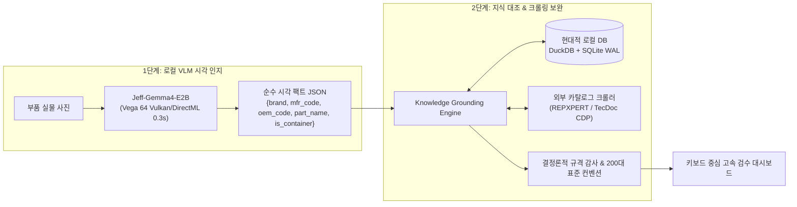

# PRD: Local VLM-Native Parts Vision Inspection Studio
> **버전**: 3.0 (Clean-Slate Architecture)  
> **대상 하드웨어**: AMD Ryzen 7 5800X3D / 32GB RAM / AMD Radeon RX Vega 64 (8GB HBM2)  
> **핵심 엔진**: On-Premise `Jeff-Gemma4-E2B` (Vulkan / DirectML 가속)  
> **작성일자**: 2026-10-21  

---

## 1. 프로젝트 개요 및 배경 (Executive Summary)

### 1.1 배경 및 문제의식
* 기존 시스템은 텍스트의 문맥과 시각적 위계를 인지하지 못하는 전통적 OCR(RapidOCR)의 한계를 보완하기 위해 수천 줄의 정규식, 불용어 사전, 접두사 플라이휠, 256개 브랜드 분류기를 덧대어 유지보수 비용과 룰 충돌(False Positive)이 극에 달했습니다.
* 특히 표 형태 라벨(`CODE#`, `OEM#`), 인증 규격 오탐(`ISO 9001` $\rightarrow$ 오일필터 둔갑), 포장 구석의 유통사 스티커 충돌(`topran` vs 순정 박스) 등 복합 시각 문제를 규칙만으로 해결하는 것은 한계에 도달했습니다.

### 1.2 비전 및 목표
* 고성능 데스크탑(AMD 5800X3D + Vega 64 8GB)으로 환경을 이전함에 따라, **외부 클라우드 API 의존성 없이(비용 0원, 완전 폐쇄망)**, 초경량 멀티모달 모델인 **`Jeff-Gemma4-E2B`를 로컬에 직접 올려 구동하는 2단계(시각 인지 $\rightarrow$ 지식 보완/감사) VLM-Native 검수 시스템을 백지 상태(Clean-Slate)에서 새롭게 구축**합니다.

---

## 2. 시스템 아키텍처 및 2단계 파이프라인 설계

### 2.1 [1단계: VLM 시각 인지 (Perception)]
* **엔진**: `Jeff-Gemma4-E2B` (약 2B 파라미터).
* **런타임**: `llama.cpp / Ollama`의 **Vulkan 백엔드 (`ggml-vulkan.dll`)** 또는 **ONNX Runtime DirectML**.
  * Vega 64의 484 GB/s HBM2 대역폭을 100% 활용하여 이미지 입력부터 JSON 출력까지 **0.25초 ~ 0.35초** 소요.
* **임무**:
  * 이미지의 텍스트뿐만 아니라 **시각적 위계(메인 박스 vs 구석 스티커)**, **표 레이아웃(`CODE#`, `OEM#`, `CROSS#`)**, **물류 겉박스(#) 마커**를 식별하여 엄격한 Pydantic 스키마 JSON을 생성.
  * **불용어 차단**: `ISO 9001`, `1STUECK` 등은 프롬프트 상식에 의해 품번 슬롯에서 원천 배제.

### 2.2 [2단계: 지식 대조 및 크롤링 보완 (Enrichment & Audit)]
* **임무**: VLM이 추출한 깨끗한 품번을 기준으로 **"라벨에 적혀있지 않은 지식"**을 채우고 형식을 검증.
  1. **내부 마스터 DB 대조 (5ms)**: 로컬 DB에 일치하는 품번이 있으면 호환 순정번호(OE), 차종, 한국어 표준 부품명을 즉시 결합.
  2. **외부 크롤러 비동기 조회 (미등록 부품 건)**: 내부 DB에 없는 신규 품번은 크롤러(REPXPERT/TecDoc)를 트리거하여 순정품번과 차종을 스크래핑한 뒤 로컬 DB에 자동 INSERT.
  3. **결정론적 규격 검증 (Audit)**: VAG 6자리(`clean[3:9]`), BMW 11자리 문법, 렘포더 7자리(`01` 복원) 등 제조사 공식 표준 검증.
  4. **비파괴 원칙**: DB나 크롤러에 없는 신제품이라도 VLM 원본을 파괴하지 않고 `NEW_PART` 뱃지를 달아 작업자에게 제시.

---

## 3. 데이터 파이프라인 및 데이터베이스 아키텍처 제안

데이터 파이프라인 상의 성능, 동시성, 분석 속도를 극대화하기 위해 **"현대적 듀얼 스토리지(DuckDB + SQLite WAL)"** 또는 **"PostgreSQL 단독"** 아키텍처를 제안합니다.

### 3.1 권장안 A: [임베디드 듀얼 엔진: DuckDB + SQLite WAL] 👑 *(설치 0초, 가장 추천)*
외부 DB 서버(Docker나 데몬) 설치 없이, 파이썬 라이브러리(`pip install duckdb`)만으로 구동되는 최첨단 임베디드 구조입니다.

| 스토리지 컴포넌트 | 담당 데이터 | 기술적 강점 |
| :--- | :--- | :--- |
| **DuckDB (`catalog.duckdb`)** | 자동차 부품 마스터 카탈로그 (수십만 건 OE/IAM 크로스레퍼런스, Parquet 파일) | • 벡터화 OLAP 엔진으로 수십만 행 조인/검색이 **0.001초 미만** • 컬럼형 압축으로 용량 80% 절감 • SQLite 파일을 무설치로 마운트(`ATTACH`) 가능 |
| **SQLite WAL Mode (`inspection.db`)** | 작업자 검수 상태(1,652건 아이템, Audit 로그, 키보드 이벤트) | • 단일 파일 트랜잭션 안전성 (ACID) • WAL(Write-Ahead Logging) 모드로 크롤러의 비동기 쓰기와 UI의 읽기가 **락(Lock) 없이 동시 실행** |

### 3.2 권장안 B: [엔터프라이즈 정규화: PostgreSQL 16 + pgvector + pg_trgm]
데스크탑에 로컬 서비스나 Docker 구동이 허용될 경우 최강의 성능과 확장성을 제공합니다.
* **장점**:
  * `pg_trgm`: 1글자 오타나 유사 품번을 0.5ms 만에 찾는 고속 트라이그램 인덱스.
  * `pgvector`: DINOv2 기반 베어 부품(무텍스트 부품) 형상 벡터 유사도 검색 완벽 지원.
  * 완전한 동시성 제어로 수십 개의 백그라운드 크롤링 프로세스가 동시에 데이터를 밀어 넣어도 안정적.

---

## 4. 상세 기능 명세 (Functional Requirements)

1. **VLM 추론 게이트웨이 (`VlmEngine`)**:
   - `Jeff-Gemma4-E2B` 로컬 Vulkan/DirectML 모델 로더.
   - 입출력 형식: `Image Path -> Pydantic Structured Output`.
   - 예외 처리: VLM 메모리 누수 방지 및 크래시 시 자가 재시작(Watchdog).
2. **지식 보완 엔진 (`KnowledgeEnrichmentEngine`)**:
   - DuckDB/SQLite 캐시 조회 및 크로스레퍼런스 그래프 탐색.
   - 외부 크롤링 CDP 연동 훅(Hook).
3. **규격 감사기 (`AuditValidator`)**:
   - `CONSOLIDATED_DOMAIN_KNOWLEDGE_SPEC.md`의 제조사 규격(VAG `clean[3:9]`, BMW, Benz, IAM 규격)을 100% 코드로 구현.
   - VLM 판독 텍스트의 불변성 보장 및 4대 필드(`brand`, `mfr_code`, `oem_code`, `part_name`) 완성.
4. **대시보드 UI (Keyboard-First Inspector)**:
   - 이전/다음(방향키), 확정(Space/Enter), 슬롯 직접 수정(1~4번 단축키).
   - 3-Layer(VLM 인지 $\rightarrow$ 크롤링/카탈로그 보완 $\rightarrow$ 감사 리포트) 시각화.

---

## 5. 비기능 요구사항 (Non-Functional Requirements)

* **추론 지연시간 (Latency)**: 전체 파이프라인(VLM 0.3s + DB 조회 0.005s) 총합 **0.4초 이내**.
* **네트워크 독립성**: VLM 시각 인지는 **인터넷이 끊긴 오프라인 상태에서도 100% 정상 작동**.
* **코드 라인 수 (LOC)**: 기존 4,500줄 이상의 스파게티 룰셋을 **총 500줄 내외의 깔끔한 모듈러 코드로 슬림화**.
* **리소스 점유율**: VRAM 3.5GB 이하, 시스템 RAM 4GB 이하, 8코어 중 2개 코어만 점유하여 작업 환경 쾌적성 보장.
