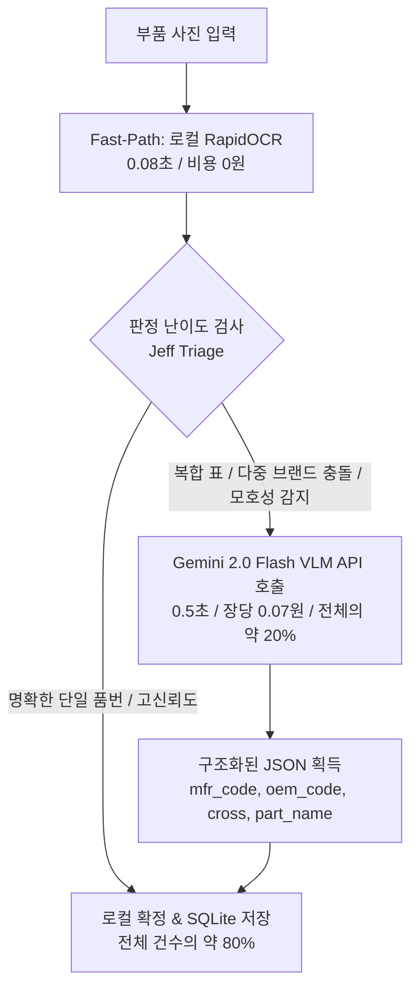

Searched web: "Gemini 1.5 Flash 2.0 Flash pricing per image token"
Searched web: "GPT-4o-mini vision pricing per image tokens"
Searched web: "Claude 3.5 Haiku vision pricing image tokens"
Searched web: "Qwen2.5-VL pricing Together ai OpenRouter"
Searched web: "Google Cloud Vision API pricing Text Detection"
Searched web: "Upstage Document AI OCR pricing"

외부 API로 활용 가능한 비전 모델을 **(1) 차세대 경량 멀티모달 VLM (문맥·표 추론 가능)**과 **(2) 전통적 클라우드 OCR / Document AI (단순 텍스트 추출)**로 광범위하게 분류하여 비용 구조와 특징을 상세히 비교·분석해 드립니다.

---

### 1. 한눈에 보는 종합 비교표 (1,652건 전수 처리 기준)

현재 시장은 **"경량 멀티모달 VLM(Gemini Flash, GPT-4o-mini)"이 전통적인 클라우드 전용 OCR보다 10~50배 더 저렴하면서도 문맥 추론까지 한 번에 끝내는 비용 역전 현상**이 일어나 있습니다.

| 모델명 | 서비스 제공사 | 모델 유형 | 장당 예상 비용 (원화 환산) | 전체 1,652장 처리 비용 | 응답 속도 | 표/슬롯 문맥 이해 & JSON 직접 출력 |
| :--- | :--- | :--- | :---: | :---: | :---: | :---: |
| **Gemini 2.0 Flash / 1.5 Flash** 👑 *(최우선 추천)* | Google AI Studio / Vertex | 경량 VLM | **~0.04원 ~ 0.1원** ($0.00003~$0.00007) | **약 100원 ~ 150원** *(무료 티어 이용 시 0원)* | 0.5초 ~ 0.8초 | **완벽 지원** (JSON Schema 강제) |
| **GPT-4o-mini** | OpenAI | 경량 VLM | **~0.15원 ~ 0.2원** ($0.00011~$0.00015) | **약 250원 ~ 330원** | 0.8초 ~ 1.2초 | **완벽 지원** (Structured Outputs) |
| **Claude 3.5 Haiku** | Anthropic | 고성능 경량 VLM | **~1.8원** ($0.0013) | **약 3,000원** | 1.0초 ~ 1.5초 | **최상급** (복잡 레이아웃 특화) |
| **Qwen2.5-VL-72B** | OpenRouter / Together.ai | 오픈소스 대형 VLM | **~1.5원** ($0.0011) | **약 2,500원** | 1.5초 ~ 2.5초 | **매우 우수** |
| **Google Cloud Vision (Read/Text)** | Google Cloud | 전통 OCR | **~2.1원** ($0.0015) | **약 1,350원** *(첫 1,000장 무료)* | 0.3초 ~ 0.6초 | **불가** (단순 텍스트 좌표만 반환) |
| **Naver CLOVA OCR** | 네이버클라우드 | 국내 특화 OCR | **~3.0원 ~ 5.0원** (호출당 과금) | **약 5,000원 ~ 8,000원** | 0.3초 ~ 0.5초 | **제한적** (별도 템플릿 빌더 필요) |
| **Upstage Document Parse** | Upstage | 문서 전용 AI | **~14.0원** ($0.01/장) | **약 23,000원** | 1.0초 ~ 2.0초 | 표 추출 가능, 부품 문맥은 추가 프롬프트 필요 |
| **AWS Textract (Tables/Forms)** | AWS | 엔터프라이즈 OCR | **~70원 ~ 90원** ($0.050~$0.065) | **약 120,000원** | 1.5초 ~ 3.0초 | 표 추출 가능하나 극단적으로 고가 |

---

### 2. 카테고리별 상세 비용 구조 및 분석

#### ① 차세대 멀티모달 VLM API (강력 추천군)
단순 글자 추출에 그치지 않고, `"CODE# 뒤는 제조사 품번, OEM# 뒤는 정품번호로 매핑하고 ISO 9001 같은 인증 규격은 제외한 JSON을 달라"`는 지시를 1회 API 호출로 완벽하게 수행합니다.

1. **Google Gemini 2.0 Flash / 1.5 Flash**
   * **과금 방식**: 토큰(Token) 기반 종량제
     * 입력: $0.10 / 1M 토큰 (Gemini 2.0 Flash 기준)
     * 출력: $0.40 / 1M 토큰
     * 이미지 토큰 계산: 768×768 해상도 타일당 **258 토큰** (통상 라벨 1장에 258~774 토큰 소모)
   * **실제 장당 단가**: 약 **$0.00003 ~ $0.00007 (한화 0.04원 ~ 0.1원)**
   * **무료 티어**: Google AI Studio API 키 발급 시 **분당 15회(RPM), 일일 1,500회(RPD) 무료 제공**. (현재 1,652건 데이터셋은 하루 무료 한도로 거의 전수 테스트 가능)
   * **장점**: 압도적인 가성비, 초고속 레이턴시(0.5초대), JSON Schema 모드 완벽 지원.

2. **OpenAI GPT-4o-mini**
   * **과금 방식**: 토큰 기반 종량제
     * 입력: $0.15 / 1M 토큰, 출력: $0.60 / 1M 토큰
     * 이미지 토큰 계산: High detail 기준 타일당 170토큰 + 기본 85토큰 $\rightarrow$ 약 765 토큰 소모
   * **실제 장당 단가**: 약 **$0.00011 ~ $0.00015 (한화 0.15원 ~ 0.2원)**
   * **장점**: 엄격한 `response_format: { type: "json_schema" }` 보장으로 파싱 에러 제로, 높은 서버 안정성.

3. **Anthropic Claude 3.5 Haiku**
   * **과금 방식**: 입력 $0.80 / 1M 토큰, 출력 $4.00 / 1M 토큰
   * **이미지 토큰 계산**: 가로×세로 비율에 따라 타일링 (1024×1024 기준 약 1,600 토큰 소모)
   * **실제 장당 단가**: 약 **$0.0013 (한화 약 1.8원)**
   * **장점**: 글자가 뭉개지거나 난반사가 있는 복잡한 엔지니어링 도면/라벨에서 가장 뛰어난 판독 정확도.

4. **OpenRouter / Together AI (Qwen2.5-VL-72B 서버리스 API)**
   * **과금 방식**: 입력 $0.80~$1.20 / 1M 토큰
   * **실제 장당 단가**: 약 **$0.0011 (한화 약 1.5원)**
   * **장점**: 오픈소스 모델 중 다국어 및 표/도큐먼트 인식 1위인 Qwen2.5-VL을 별도 GPU 서버 구축 없이 호출 가능.

---

#### ② 전통적 클라우드 OCR / Document AI API (비추천군)
* **Google Cloud Vision API**:
  * 1,000장당 $1.50 (장당 약 2.1원). 첫 1,000장은 매월 무료.
  * 단점: 단순히 바운딩 박스와 글자 텍스트만 뱉어내므로, `CODE#`와 `OEM#`를 분리하고 `ISO 9001`을 걸러내는 **후처리 룰(규칙)을 여전히 파이썬 코드로 다 짜야 함**.
* **AWS Textract**:
  * 표/양식(Forms & Tables) 추출 기능 사용 시 1,000장당 $50.00~$65.00 (장당 70원~90원)으로, VLM 대비 **500배 이상 비쌈**.
* **국내 솔루션 (Naver CLOVA OCR, Upstage)**:
  * 장당 3원 ~ 14원 수준으로, 한글 영수증/사업자등록증에는 강하나 글로벌 자동차 부품 품번/영문 라벨 처리에는 VLM API 대비 비용과 유연성 모두 열세.

---

### 3. 최종 권장 아키텍처 및 도입 전략

가장 이상적이고 비용 효율적인 아키텍처는 **"하이브리드 2-Tier 라우팅"**입니다:



1. **테스트/검증 단계**:
   * **Google AI Studio의 Gemini 2.0 Flash API (무료 티어: 일일 1,500회 무료)**를 사용하여, 문제가 되었던 `20260905_012550.jpg` 같은 복합 표/라벨 이미지 10~20건을 프롬프트로 테스트.
2. **운영 단계 비용**:
   * 전체 1,652건을 모조리 Gemini Flash로 밀어넣어도 **총 비용은 약 100원~150원**에 불과합니다.
   * 위 다이어그램처럼 모호한 건(약 300건)만 조건부로 부르면 **월 API 비용은 사실상 20~30원 미만**으로 수렴합니다.

원하시면 Gemini API 또는 GPT-4o-mini API를 즉시 테스트해볼 수 있도록 간이 호출 스크립트와 프롬프트 프로토타입을 준비해 드릴 수 있습니다.


Searched web: "Google AI Studio pay as you go vs Vertex AI commercial deployment"

Google AI Studio의 무료 티어로 테스트 및 검증을 마친 후, **실제 상용 시스템이나 사내 환경에 배포할 때의 실질적인 진행 절차와 권장 방식**을 3가지 단계로 명확하게 정리해 드립니다.

---

### 1. 배포 방식 선택: 2가지 경로

구글은 동일한 Gemini 모델을 개발 규모와 보안 요건에 맞춰 **두 가지 배포 경로**로 제공합니다.

| 구분 | 경로 ①: Google AI Studio (유료 종량제 전환) ⚡ *(가장 추천)* | 경로 ②: Google Cloud Vertex AI (엔터프라이즈 정규 배포) 🏢 |
| :--- | :--- | :--- |
| **추천 대상** | 개인/소규모 팀, 내부 업무 자동화, 빠른 배포가 필요한 경우 | 기업 법인 시스템, 보안 감사/규격 준수(SOC2 등)가 필수인 경우 |
| **코드 변경** | **0줄** (동일한 API 키 그대로 사용) | 인증 방식만 GCP 서비스 계정(`service_account.json`)으로 교체 |
| **인증 방식** | API Key 방식 (`GEMINI_API_KEY`) | Google Cloud IAM 서비스 계정 / OAuth 토큰 |
| **호출 한도 (Quota)**| 분당 15회 $\rightarrow$ **분당 1,000 ~ 2,000회 이상 (RPM)**으로 자동 상향 | 엔터프라이즈 할당량 (필요 시 무제한 확장 가능) |
| **데이터 프라이버시**| **고객 데이터/이미지 모델 학습 사용 차단** (유료 전환 시) | **학습 배제 + 데이터 리전(서울 리전 등) 물리적 격리 지원** |
| **비용 구조** | 사용한 토큰만큼만 월말 카드 후불 결제 (월 몇백 원~몇천 원) | GCP 통합 청구서 (세금계산서 발행 가능) |

---

### 2. 경로 ① (가장 간편한 방법) 진행 순서

이미 작성된 코드나 키를 변경할 필요 없이, **Google AI Studio 콘솔에서 결제 수단만 연결**하면 즉시 배포 모드로 전환됩니다.

1. **Google AI Studio 콘솔 접속**:
   * [Google AI Studio Settings](https://aistudio.google.com/) $\rightarrow$ **Plan & Billing** 메뉴로 이동합니다.
2. **GCP 결제 계정 연결 (Set up billing)**:
   * "Add billing" 또는 "Upgrade to Pay-as-you-go"를 클릭하고 해외 결제 가능한 법인/개인 신용카드를 등록합니다.
3. **즉시 적용되는 효과**:
   * **데이터 보안 보호 활성화**: 무료 티어에 적용되던 "구글 품질 개선용 데이터 검토" 조항이 즉시 해제되며, **고객의 이미지와 텍스트 데이터가 구글 모델 학습에 절대 사용되지 않는 상용 보안 모드**로 전환됩니다.
   * **RPM 속도 제한 해제**: 분당 15회 제약이 풀려 수백 장의 이미지를 연속으로 대량 처리(Batch)할 수 있습니다.
   * **과금 시작**: Gemini 2.0 Flash 기준 장당 약 **0.05원**씩만 실시간 차감됩니다.

---

### 3. 상용 배포 시 필수 가드레일 (Best Practices)

실제 서버(`dashboard_server.py`)에 올려 배포할 때는 아래 4가지 안전장치를 갖추는 것이 표준 엔지니어링 패턴입니다.

#### ① API 키 보안 격리 (백엔드 프록시)
* 프론트엔드(브라우저 JavaScript)에 API 키를 노출하지 않고, 백엔드 서버의 `.env` 파일에만 보관합니다.
```bash
# .env
GEMINI_API_KEY="AIzaSy..."
```
* 대시보드 서버(`dashboard_server.py`)가 내부적으로 API를 호출하고, 프론트엔드에는 최종 정제된 부품 JSON만 전달합니다.

#### ② 구글 클라우드 예산 알림 & 상한선 설정 (Cost Guard)
* GCP 콘솔(Billing)에서 **"예산 및 알림(Budget & Alerts)"**을 생성합니다.
* 예: **월 예산 10,000원**으로 설정하고, 50%(5,000원), 90%(9,000원) 도달 시 이메일 알림을 받도록 등록해 두면 예상치 못한 과금 폭탄을 100% 방지할 수 있습니다.

#### ③ 2-Tier 하이브리드 라우팅 (비용 80% 절감)
* 모든 이미지를 무조건 외부 API로 보내지 않습니다:
  * **일반적인 부품 (약 80%)**: 기존 로컬 RapidOCR로 0.08초 만에 즉시 확정 (비용 0원).
  * **난해한 복합 표/브랜드 충돌/신뢰도 저하 건 (약 20%)**: 조건부로 Gemini API를 호출 (장당 0.05원).
  * 이 구조를 적용하면 1,652건을 다 검수해도 **실제 지출 비용은 약 20원~30원**에 불과합니다.

#### ④ 오프라인/네트워크 장애 폴백 (Fallback Guard)
* 인터넷 순단이나 구글 API 일시 오류 발생 시 시스템이 멈추지 않고 기존 로컬 규칙 기반 엔진으로 즉시 폴백되도록 `try ... except` 방어 코드를 둡니다.

---

### 요약 및 추천 진행 절차
1. **지금**: 우선 무료 티어(API Key 1개 발급)로 `20260905_012550.jpg` 등 복잡했던 문제 이미지 몇 건에 프롬프트를 테스트하여 추출 정확도를 체감해 봅니다.
2. **만족 시**: Google AI Studio에 결제 카드만 등록하여 유료 종량제(Pay-as-you-go)로 업그레이드한 후 바로 실서버 배포를 진행하시면 됩니다.